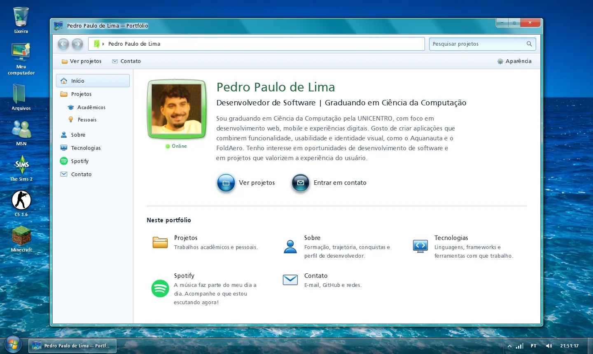

# Portfólio Aero

Portfólio pessoal de **Pedro Paulo de Lima**, desenvolvedor de software e graduando em Ciência da Computação (UNICENTRO). O site imita uma janela do Windows 7 com vidro Aero, aberta sobre uma área de trabalho decorativa. Funciona em português e inglês.

> **English:** Personal portfolio of Pedro Paulo de Lima, software developer and Computer Science undergraduate. It looks like a Windows 7 Aero glass window on a decorative desktop, and it is fully bilingual (Portuguese/English): the language follows the visitor's browser and can be switched from the taskbar.



## Funcionalidades

- **Janela Aero navegável:** voltar/avançar sincronizados com o navegador, barra de localização, pesquisa de projetos e menu Iniciar com tema claro/escuro e três modos de vidro.
- **Projetos** com filtro por categoria, busca e janela de detalhes com galeria de capturas.
- **Spotify ao vivo:** perfil, música tocando agora, últimas faixas e mais ouvidos do mês, servidos por uma função serverless (as credenciais nunca chegam ao navegador). Botão para atualizar na hora.
- **Bilíngue:** idioma detectado pelo navegador, troca pelo indicador PT/EN da barra de tarefas. O build falha se algum texto ficar em uma língua só.
- **Som de fundo** em loop, com controle de volume na bandeja (e atalho para silenciar logo no início da página).
- **Acessível e responsivo:** navegação completa por teclado, leitores de tela, preferência por menos movimento, de 320 px a telas largas.

## Tecnologias

React 19 · TypeScript (strict) · Vite · CSS puro (sem framework) · Web Audio API · função serverless na Vercel para a API do Spotify · ESLint e Prettier.

## Como rodar

Requer **Node.js 20.19+ ou 22.12+**.

```bash
npm install
npm run dev        # http://localhost:5173
```

Sem as credenciais do Spotify, a aba mostra dados de exemplo durante o desenvolvimento. Para ligar a integração, copie `.env.example` para `.env.local`, preencha as chaves e gere o refresh token com `npm run spotify:auth`. O passo a passo está no [guia](docs/GUIA.md#8-spotify).

### Scripts

| Comando                | O que faz                                                           |
| ---------------------- | ------------------------------------------------------------------- |
| `npm run dev`          | servidor de desenvolvimento                                         |
| `npm run build`        | checagem de tipos + build de produção em `dist/`                    |
| `npm run preview`      | serve o build localmente (com a função do Spotify)                  |
| `npm run check`        | lint, verificação de traduções, formatação e build                  |
| `npm run i18n:check`   | acusa texto de interface escrito fora das traduções                 |
| `npm run images`       | gera as imagens otimizadas a partir dos originais (Python + Pillow) |
| `npm run tech-icons`   | baixa os ícones das tecnologias (Devicon e Simple Icons)            |
| `npm run spotify:auth` | obtém o refresh token do Spotify e grava em `.env.local`            |

## Publicação

O projeto está pronto para a **Vercel**: o build é estático (`dist/`) e `api/spotify.ts` vira a função `/api/spotify`. Nas variáveis de ambiente do projeto, cadastre `SPOTIFY_CLIENT_ID`, `SPOTIFY_CLIENT_SECRET` e `SPOTIFY_REFRESH_TOKEN`. Em hospedagens só estáticas (GitHub Pages), o site funciona sem a aba do Spotify.

## Estrutura

```
src/data/portfolio.ts   todo o conteúdo do site, em português e inglês
src/i18n/               textos da interface e troca de idioma
src/components/         janela, área de trabalho, menu Iniciar, seções e Spotify
src/assets/             imagens otimizadas (originais em src/assets/originais/)
server/ e api/          função do Spotify (núcleo + adaptador da Vercel)
scripts/                imagens, ícones, traduções e autenticação do Spotify
aero-ui-kit/            kit visual Aero usado como referência e fonte de recursos
docs/GUIA.md            guia completo de personalização e manutenção
```

## Créditos

- Ícones de tecnologias: [Devicon](https://devicon.dev) (MIT) e [Simple Icons](https://simpleicons.org) (CC0). As marcas pertencem aos seus donos.
- Logos do Windows, do Spotify e dos jogos e programas da área de trabalho são marcas de terceiros, usadas apenas como referência visual.
- Fonte Frutiger e recursos do Aero UI Kit: veja [`aero-ui-kit/LEIA-ME.md`](aero-ui-kit/LEIA-ME.md).

## Autor

**Pedro Paulo de Lima** — [github.com/PedroPaulo00](https://github.com/PedroPaulo00)
