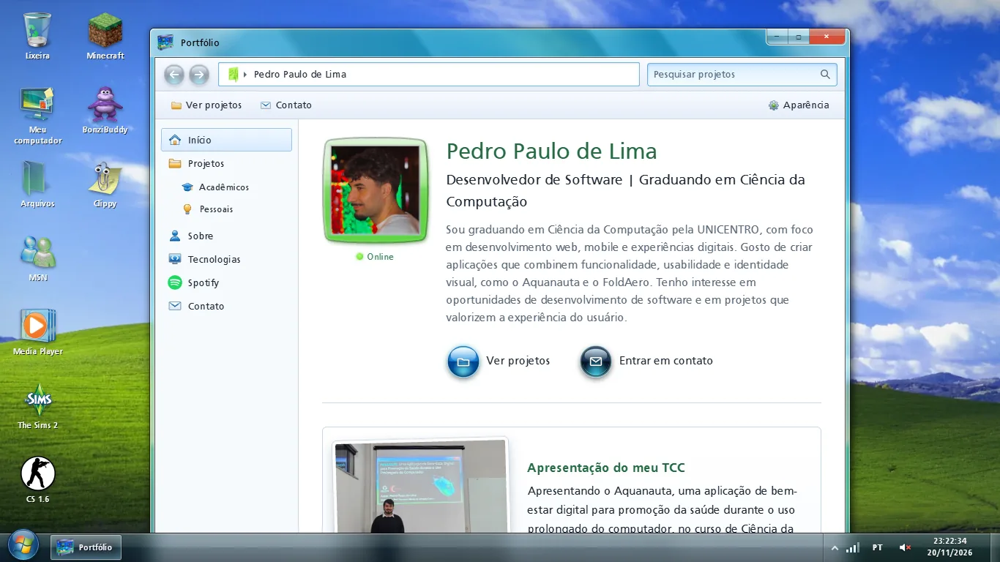
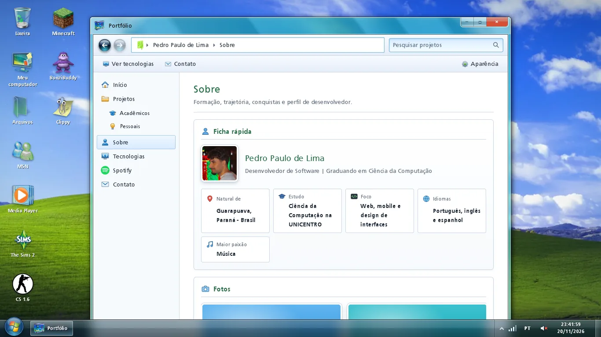
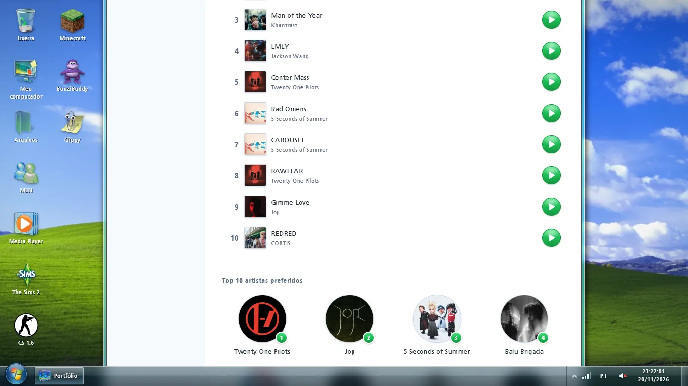
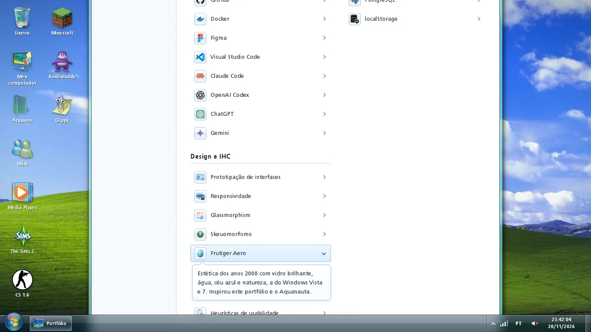
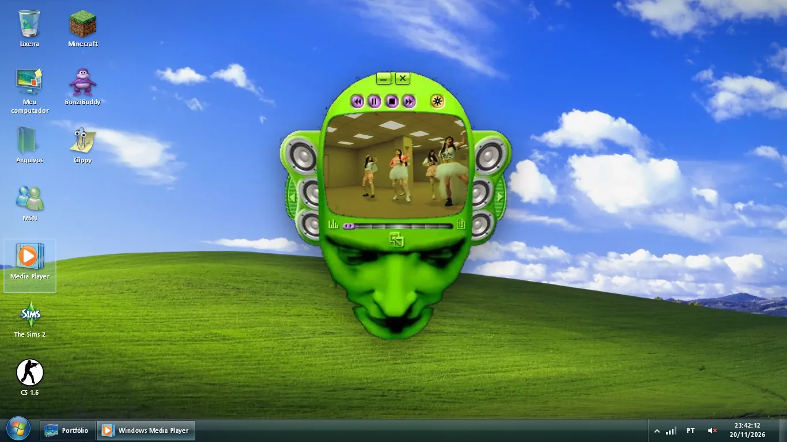

# Portfólio Aero

Portfólio pessoal de **Pedro Paulo de Lima**, desenvolvedor de software e graduando em Ciência da Computação (UNICENTRO). O site é um computador do Windows 7: começa desligado, liga com a animação de inicialização e abre uma janela Aero de vidro sobre uma área de trabalho cheia de atalhos que funcionam. Funciona em português e inglês.

**Site no ar:** [portfolio-pedropaulo.vercel.app](https://portfolio-pedropaulo.vercel.app)

> **English:** Personal portfolio of Pedro Paulo de Lima, software developer and Computer Science undergraduate. The site is a Windows 7 computer: it starts turned off, boots with the Windows startup animation and opens an Aero glass window over a desktop full of working shortcuts. It is fully bilingual (Portuguese/English): the language follows the visitor's browser and can be switched from the taskbar.



|                                   Sobre                                    |                           Meus preferidos no Spotify                           |
| :------------------------------------------------------------------------: | :----------------------------------------------------------------------------: |
|                                 |                             |
|                              **Tecnologias**                               |                      **Área de trabalho e Media Player**                       |
|  |  |

## Funcionalidades

### O portfólio

- **Janela Aero navegável:** voltar/avançar sincronizados com o navegador, barra de localização, pesquisa de projetos e menu Iniciar com tema claro/escuro (com papel de parede de dia e de noite) e três modos de vidro.
- **Início** com foto, apresentação e destaque da apresentação do TCC.
- **Projetos** com filtro por categoria, busca, modos de exibição como os do Explorer (ícones grandes, lista, detalhes...) e janela de detalhes com galeria de capturas. O Aquanauta tem o botão **Artigo do TCC**, que pede confirmação antes de levar ao artigo no Google Drive.
- **Sobre** em cartões: ficha rápida (de onde sou, o que estudo, foco, idiomas e paixão), carrossel de fotos, história, conquistas, formação, interesses e idiomas.
- **Tecnologias** em grupos, com ícone em cada item. Ao clicar, uma explicação curta do que é a ferramenta.
- **Spotify ao vivo:** perfil, música tocando agora e últimas faixas, servidos por uma função serverless (as credenciais nunca chegam ao navegador). Mais o **top 10 de músicas e de artistas preferidos** (escolhidos à mão, não os mais ouvidos), com capas e fotos vindas do Spotify e prévia de cada música pelo player oficial, aberta por um orbe verde.
- **Contador de visitas** discreto no Início, sem contar o próprio dono.
- **Bilíngue:** idioma detectado pelo navegador, troca pelo indicador PT/EN da barra de tarefas. O build falha se algum texto ficar em uma língua só.

### O computador

- **Tela de ligar:** o site abre "desligado". O botão de energia toca a animação de inicialização e revela a área de trabalho, de onde se abre o portfólio pelo ícone.
- **Janela de verdade:** minimizar (encolhe até a barra de tarefas), fechar e reabrir pelo ícone.
- **Barra de tarefas:** botão Iniciar, botões das janelas abertas (com miniatura ao passar o mouse), volume, idioma e relógio que abre um calendário Aero funcional.
- **Desligar e reiniciar** pelo menu Iniciar, com as telas "Desligando..." e "Reiniciando...".
- **Ícones da área de trabalho que funcionam:** a Lixeira mostra seu conteúdo; o **MSN** abre o Messenger e o "chamar a atenção" (a mão bate na tela, a janela treme e toca um "toc toc"); o **Media Player** toca vídeos na skin da cabeça verde, com anterior, próximo, pausa, minimizar e fechar; o **Clippy** comenta o que você está vendo e dá dicas; o **BonziBuddy** surfa pela tela até ser clicado. Tudo o que abre aparece na barra de tarefas.
- **Som de fundo** em loop, a partir do momento em que o portfólio é aberto, com controle de volume na bandeja. Ele para ao fechar a janela, ao trocar de aba e ao minimizar o navegador, e se cala sozinho enquanto um vídeo ou uma prévia do Spotify toca.
- **Acessível e responsivo:** navegação completa por teclado, leitores de tela, preferência por menos movimento, de 320 px a telas largas, em Chrome, Edge e Safari (testado com os motores Chromium e WebKit).

## Tecnologias

React 19 · TypeScript (strict) · Vite · CSS puro (sem framework) · Web Audio API · funções serverless na Vercel (Spotify e contador de visitas) · Upstash Redis (contador) · ESLint e Prettier.

## Como rodar

Requer **Node.js 20.19+ ou 22.12+**.

```bash
npm install
npm run dev        # http://localhost:5173
```

Sem as credenciais do Spotify, a aba mostra dados de exemplo durante o desenvolvimento. Para ligar a integração, copie `.env.example` para `.env.local`, preencha as chaves e gere o refresh token com `npm run spotify:auth`. O passo a passo está no [guia](docs/GUIA.md#8-spotify).

### Scripts

| Comando                | O que faz                                                                  |
| ---------------------- | -------------------------------------------------------------------------- |
| `npm run dev`          | servidor de desenvolvimento                                                |
| `npm run build`        | checagem de tipos + build de produção em `dist/`                           |
| `npm run preview`      | serve o build localmente (com as funções do Spotify e das visitas)         |
| `npm run check`        | lint, verificação de traduções, formatação e build                         |
| `npm run i18n:check`   | acusa texto de interface escrito fora das traduções                        |
| `npm run images`       | gera as imagens otimizadas a partir dos originais (Python + Pillow)        |
| `npm run tech-icons`   | baixa os ícones das tecnologias (Devicon e Simple Icons)                   |
| `npm run spotify:auth` | obtém o refresh token do Spotify e grava em `.env.local`                   |
| `npm run placeholders` | lista o que ainda é conteúdo provisório (fotos, links, textos a preencher) |

## Publicação

O projeto está pronto para a **Vercel**: o build é estático (`dist/`) e a pasta `api/` vira as funções do site:

- `/api/spotify`: perfil, tocando agora e últimas faixas;
- `/api/spotify-favorites`: capas e fotos do top 10 (cache de um dia);
- `/api/visits`: contador de visitas.

Nas variáveis de ambiente do projeto, cadastre `SPOTIFY_CLIENT_ID`, `SPOTIFY_CLIENT_SECRET` e `SPOTIFY_REFRESH_TOKEN`. O contador usa um banco Upstash Redis ligado pela Vercel (ela cria `KV_REST_API_URL` e `KV_REST_API_TOKEN`); sem ele, o contador simplesmente não aparece. **Nenhum segredo vai para o repositório:** use apenas `.env.local` (ignorado pelo Git) e as variáveis da Vercel. Em hospedagens só estáticas (GitHub Pages), o site funciona sem a aba do Spotify e sem o contador.

## Conteúdo e personalização

Todo o conteúdo fica em `src/data/portfolio.ts`, em português e inglês. O [guia](docs/GUIA.md) explica, passo a passo, como:

- trocar fotos, papéis de parede e ícones (`npm run images`);
- preencher o carrossel de fotos do Sobre e a ficha rápida;
- escolher o top 10 do Spotify (cole os links ou IDs na ordem);
- adicionar um botão de artigo, com confirmação, a um projeto (`articleUrl`);
- acrescentar vídeos ao Media Player;
- configurar os ícones da área de trabalho (janela, imagem, personagem ou assistente);
- adicionar uma ferramenta e a explicação dela em Tecnologias.

## Estrutura

```
src/data/portfolio.ts   todo o conteúdo do site, em português e inglês
src/data/skillInfo.ts   explicação curta de cada ferramenta (Tecnologias)
src/i18n/               textos da interface e troca de idioma
src/components/         janela, área de trabalho, menu Iniciar, seções e Spotify
src/lib/                som de fundo, rotas, Spotify, visitas e barra de tarefas
src/assets/             imagens e vídeos otimizados (originais em src/assets/originais/)
server/ e api/          funções serverless (Spotify, top 10 e visitas)
scripts/                imagens, ícones, traduções e autenticação do Spotify
aero-ui-kit/            kit visual Aero usado como referência e fonte de recursos
docs/GUIA.md            guia completo de personalização e manutenção
docs/screenshots/       capturas de tela usadas neste README
```

## Privacidade

O site não usa cookies nem pede dados pessoais. Guarda no navegador só preferências (tema, idioma, volume) e conta visitas sem identificar ninguém (o endereço de rede é transformado em um código irreversível). A política completa está na própria aba **Privacidade** do site.

## Créditos

- Ícones de tecnologias: [Devicon](https://devicon.dev) (MIT) e [Simple Icons](https://simpleicons.org) (CC0). As marcas pertencem aos seus donos.
- Logos e imagens do Windows, do Spotify, do MSN, do Windows Media Player, do Clippy, do BonziBuddy, dos jogos e dos demais programas da área de trabalho, assim como o escudo da Lixeira, são marcas e obras de terceiros, usadas apenas como referência visual e de homenagem, sem fins comerciais.
- Fonte Frutiger e recursos do Aero UI Kit: veja [`aero-ui-kit/LEIA-ME.md`](aero-ui-kit/LEIA-ME.md).

## Autor

**Pedro Paulo de Lima** — [github.com/PedroPaulo00](https://github.com/PedroPaulo00)
