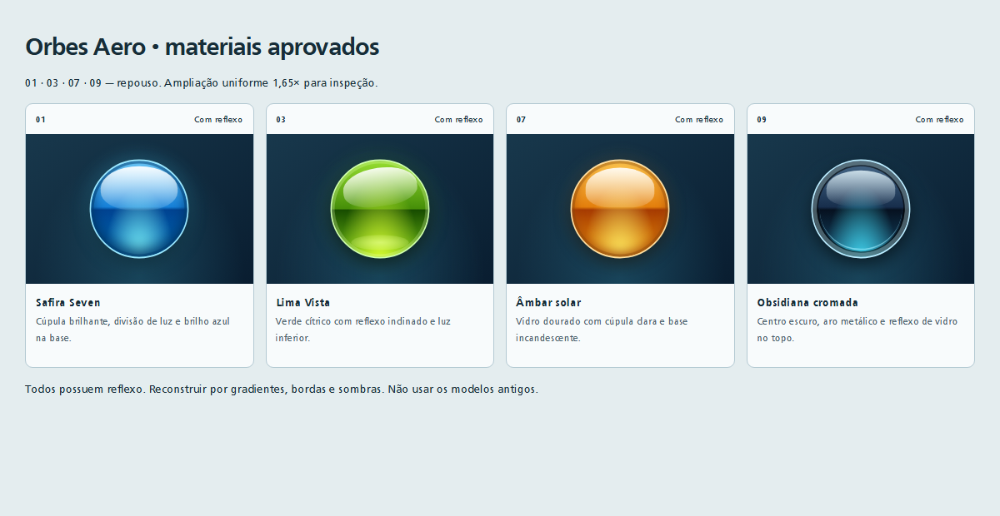
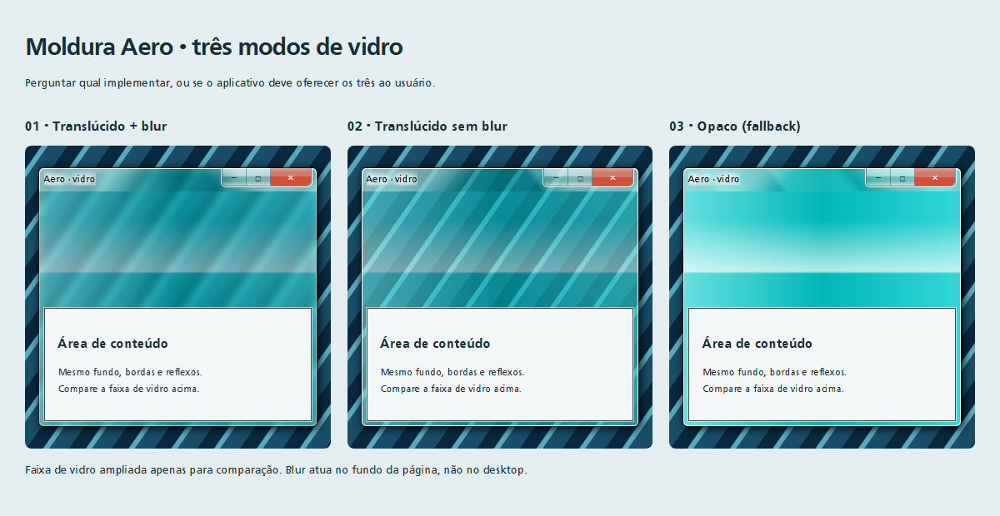
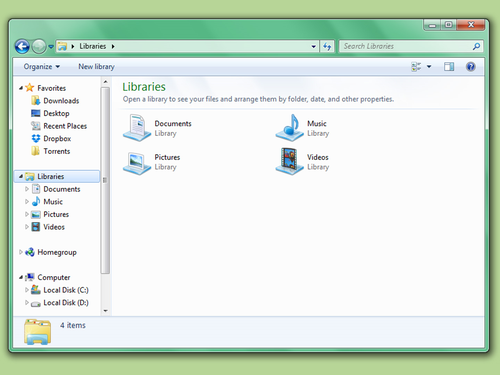

# Aero Glass Design System
Manual independente de plataforma — revisão aprovada em 10/11/2026.

**Vigente:** moldura original e somente os orbes 01, 03, 07 e 09. Os orbes antigos estão substituídos e não devem ser implementados.

## 1. Objetivo e escopo
Construir três famílias independentes: moldura Aero, orbes e campos de entrada estilizados; usar Frutiger como fonte principal do aplicativo. Podem ser adotados separadamente. Ao aplicar o kit a telas ou ao aplicativo completo, complementar os demais componentes da UI/UX com a mesma identidade visual e traduzir os padrões para a stack e plataformas do destino, conforme seções 7A e 7B. Nenhuma tela, função, fluxo, marca, personagem, imagem ou arquitetura do aplicativo de origem é requisito.

**Evidência:** A = novo material aprovado pelo usuário na prévia HTML, não extraído do TCC; E = extraído diretamente do código (valor declarado, não medição em tela); I = inferido, com justificativa; S = sugestão para novos projetos. A captura existente foi inspecionada: mostra contorno ciano com arestas claras, reflexos diagonais no topo e esferas cinza na parte inferior. Não comprova estados interativos, blur do desktop nem fidelidade do código atual. Não houve execução da aplicação: dependências locais não estão instaladas e sua inicialização aciona recursos além do escopo. Não foram instalados pacotes.

## Como aplicar este kit a qualquer produto
Este é um **sistema visual e de interação**, não um aplicativo pronto nem um requisito de reproduzir um gerenciador de arquivos. A IA deve compreender o produto e a stack, e traduzir materiais, tipografia, hierarquia, navegação e estados para componentes apropriados à sua finalidade.

| Produto de destino | Adaptação esperada |
|---|---|
| Loja no celular | Logo e nome da loja no cabeçalho; catálogo e páginas de produto próprios; campos e ações Aero; menu do logo com categorias, carrinho, pedidos ou conta apenas se essas funções existirem; navegação por toque e uma coluna quando necessário |
| Portfólio no computador/web | Logo/nome do profissional no topo; trabalhos, sobre e contato com composição apropriada; menu do logo com seções reais; materiais Aero e claro/escuro; não inventar pastas, arquivos ou carrinho |
| Ferramenta desktop | Navegação de módulos, busca e ações relacionadas ao trabalho; respeitar chrome nativo, teclado e redimensionamento |
| Outro aplicativo/plataforma | Usar seus próprios dados, regras e fluxos, mapeando tokens para primitivas locais; não exigir HTML, Electron ou um SO específico |

Preservar o visual aprovado, mas **não copiar** os nomes “Ateliê”, “Biblioteca”, “Meus projetos”, o logo demonstrativo ou funcionalidades fictícias. Barras de localização e voltar/avançar representam localização e histórico reais do produto: no site podem representar seções/rotas, na loja categorias/produtos. Se não houver hierarquia ou histórico, simplificar a estrutura e desabilitar ações indisponíveis, sem fingir navegação. As duas referências Explorer guiam o acabamento interno, não impõem árvore de pastas nem densidade de desktop em mobile.

A identidade do novo projeto é obrigatória: logo próprio e nome juntos no topo, dentro da área de cabeçalho/contorno. Usar o logo existente do produto. Se ausente, solicitar o asset ou trabalhar com marca textual temporária identificada, sem inventar uma marca definitiva. O logo demonstrativo do kit não é identidade obrigatória.

**Claro (white/light) e escuro (dark):** implementar ambos, com seletor acessível e preferência persistida; o claro usa superfícies brancas, o escuro converte somente superfícies internas/textos/controles, conforme seção 7G. Orbes, moldura, bordas externas e controles de janela ficam invariáveis. Tema e modo de vidro são decisões independentes.

## 2. DNA visual
- Aresta escura fina junto a uma aresta clara produz espessura aparente.
- Vidro ciano translúcido combina reflexo horizontal abrupto e reflexos diagonais no cabeçalho. O desfoque é secundário; não substitui as camadas.
- Sombras internas e externas separam superfície, borda e fundo.
- Os quatro orbes aprovados combinam cúpula especular superior, divisão horizontal entre luz e sombra, iluminação inferior e aros próprios de cada material.
- Resultado desejado: moldura leve com limites legíveis; esfera reconhecível como volume mesmo sem ícone. Nenhum wallpaper é necessário.

## 3. Tokens de design
Unidades geométricas abaixo são pixels CSS no original. Em outra plataforma, começar com unidades lógicas equivalentes (S), sem confundir com pixels físicos. Cores são sRGB, exceto onde OKLCH está explícito. Sombras seguem x, y, blur, expansão; expansão omitida significa zero.

| Token semântico | Valor | Evidência / origem |
|---|---|---|
| frame.radius | 6 | E, F1/F2/F3 |
| frame.edge | 1; preto alfa 0,70 | E, F1 |
| frame.shadow | 2 2 10 1; preto alfa 0,70 | E, F1 |
| frame.inner-light | inset 0 0 0 1; branco alfa 0,98 | E, F1 |
| glass.tint | HSL(180°,100%,40%) = #00CCCC | E, F2 |
| glass.group-opacity | 0,60 | E, F2; aplicado ao grupo inteiro |
| glass.inner-light | inset 0 0 0 1; branco alfa 0,99 | E, F2 |
| glass.blur | 4 | E, F3; suporte efetivo não observado |
| frame.content-inset | laterais/base 6; topo 0 | E, F5 |
| frame.content-edge | 1; preto alfa 0,70; aro externo branco alfa 0,60 de 1 | E, F5 |
| header.padding | topo 0; outros lados 6 | E, F4 |
| header.corner | 6 6 0 0 | E, F4 |
| header.corner-reflection | 135° e 225°; branco alfa 0,33 até 70; transparente em 100 | E, F4 |
| header.title | preto; entrelinha 15; topo 6; oito halos 0 0 10 brancos | E, F4 |
| control.size | mínimo 29 × 21; último 48 × 21 | E, F6 |
| control.bottom-radius | 5 | E, F6 |
| control.transition | sombra 100 ms; ease implícito | E, F6 |
| motion.ease | curva cúbica (0,25;0,10;0,25;1) | I, tradução do ease CSS |
| target.touch | área interativa mínima sugerida 48 × 48 | S; preservar diâmetro visual |
| focus.ring | 2 unidades com afastamento 2; cor contrastante | S |
| fallback.glass | #00CCCC opaco + mesmos reflexos e bordas | S; perde translucidez |
| motion.reduced | sem escala animada; transição imediata | S |

Os únicos materiais de orbe vigentes são os quatro da seção 5. Preservar seus números originais. A IA escolhe a variante adequada a cada botão conforme as regras da seção 5.

## 4. Especificação da moldura Aero
Compor do fundo para a frente:
1. Fundo externo fornecido pelo ambiente.
2. Região arredondada que solicita desfoque do que está atrás (4 unidades).
3. Grupo de vidro: base ciano; sobre ela gradiente horizontal branco/0,40 em 0%, preto/0,10 em 50%, branco/0,20 em 100%; sobre ele gradiente vertical transparente em 20%, branco/0,70 em 40%, transparente em 41%. Aplicar ao grupo opacidade 0,60 e aro interno branco/0,99.
4. Contorno preto/0,70 de 1 e iluminação interna branca/0,98 de 1; sombra exterior conforme tabela.
5. Cabeçalho com reflexos diagonais e luz nas arestas superior, esquerda e direita (sombras inset de 1, branco/0,99).
6. Abertura de conteúdo com margem 6 nas laterais/base, contorno escuro e aro branco/0,60. O conteúdo pertence ao produto de destino.

A implementação coloca o blur em z=-10, o vidro em z=-1, dentro de um contêiner com z=0. Isso descreve a intenção de empilhamento; outra stack deve usar camadas explícitas, sem reproduzir números de z-index.

O reflexo estriado inferior do cabeçalho é um gradiente a 54°, ancorado à esquerda/centro, tamanho do viewport, sem repetição e fixo. Sua sequência exata está na seção 12. Não animá-lo como se fosse água: não há essa animação.

**Geometria original:** caixa desenhada 500 × 720; janela hospedeira 520 × 720. Não são a mesma largura. A sombra pode ser limitada pelas extremidades da superfície transparente; a captura não demonstra margens completas. Altura do cabeçalho não é um token fixo declarado: resulta dos filhos e espaçamentos. Não impor a dimensão total a outros produtos.

**Estados:** não foi encontrado tratamento visual específico da moldura para foco perdido ou maximização. O botão quadrado restaura zoom, não maximiza. O host é não redimensionável; zoom varia de 0,6 a 1,5 e também escala a janela base 520 × 720. Isso não comprova responsividade. S: em maximização real, adequar raio e sombra ao SO; em foco perdido, manter legibilidade e reduzir apenas realces secundários após validação.

**Controles, somente como integração de borda:** grupo branco/0,20, borda preta/0,30 de 1 sem borda superior, raios inferiores 5 e linhas externas brancas/0,98 de 1. Superfície vertical branca/0,50 → branca/0,30 em 45% → preta/0,10 em 50% e 75% → branca/0,50. Hover comum combina luz ciano inferior e duas metades azul-claro/azul-escuro, halo azul; pressionado escurece e remove halo. Fechamento usa vermelho. Não importar comandos ou símbolos como requisito; usar convenções da plataforma. Região de arraste exclui controles.

Pseudocódigo:
~~~text
desenharMoldura(retangulo, conteudo):
    desenharSombraExterna(retangulo, frame.shadow)
    recortarMaterial(retangulo, raio=6)
    se capacidadeBackdrop: desfocarFundo(4)
    comporGrupo(opacidade=0.60):
        preencherCiano()
        sobreporGradienteHorizontal()
        sobreporFaixaVertical(20%,40%,41%)
        desenharAroInternoBranco(1,0.99)
    desenharContornoEscuroEArestaClara()
    desenharCabecalhoComReflexos()
    desenharAberturaInterna(margens=6,6,0,6)
    inserirConteudoDoNovoProduto()
~~~

## 5. Especificação dos quatro orbes aprovados
**A — substituição integral dos modelos antigos.** Não implementar o orbe neutro nem a antiga variante verde. Adotar somente os materiais abaixo:

| ID | Nome | Aparência |
|---|---|---|
| 01 | Safira Seven | Azul brilhante, cúpula clara e iluminação ciano inferior |
| 03 | Lima Vista | Verde cítrico, reflexo superior inclinado e reflexo inferior |
| 07 | Âmbar solar | Vidro dourado/laranja, cúpula clara e luz amarela na base |
| 09 | Obsidiana cromada | Núcleo azul quase preto, aro metálico e reflexo superior |

Todos possuem reflexo. Não importar os materiais sem reflexo não selecionados. Nenhuma cor implica função obrigatória.

### Escolha por botão: autonomia da IA
A IA deve analisar a finalidade, hierarquia, fundo, ícone e identidade do novo aplicativo e escolher qual dos quatro orbes combina com cada botão. **Pode e deve combinar diferentes variantes no mesmo aplicativo quando isso ajudar a hierarquia**, sem pedir ao usuário uma única variante global. Não precisa usar todas nem transformar todos os botões em círculos.

Como orientação, não significado obrigatório: 01 Safira Seven para ações principais ou navegação; 03 Lima Vista para confirmação ou ação positiva; 07 Âmbar solar para destaque ou atenção; 09 Obsidiana cromada para utilidades e ações secundárias. Adaptar à semântica já existente; não usar âmbar como confirmação se isso conflitar com o produto. Ações iguais devem conservar a mesma variante em todas as telas. Diferenciar também por rótulo e ícone, nunca só por cor.

A IA registra brevemente o mapeamento escolhido e respeita preferências explícitas do usuário. Pode adaptar diâmetro e símbolo; preserva os materiais aprovados, reflexos, aros e estados. Não inventa novas paletas ou variantes nem recupera os orbes antigos sem solicitação.

### Tokens e estados
| Token | Valor / regra |
|---|---|
| orb.diameter | 72 unidades lógicas |
| orb.radius | 50% |
| orb.border | 1 unidade; cor por material |
| orb.motion | transformação, 220 ms, ease |
| orb.hover | translateY(-3) seguido de scale(1,07) |
| orb.pressed | scale(0,94), substituindo deslocamento hover |
| orb.disabled | opacidade do grupo 0,38; sem acionamento ou hover |
| orb.focus | contorno contrastante 2; afastamento 2 |
| orb.reduced-motion | nenhuma transformação interativa ou transição |
| orb.target | mínimo 48 × 48; pode exceder disco |

Geometria, repouso, hover e pressão são A. Desabilitado, foco e redução de movimento são regras adotadas nesta revisão, não estados já presentes nas quatro amostras selecionadas.

**Interativo:** repouso com resposta ao ponteiro e à pressão. **Hover fixo:** amostra estática da transformação hover, apenas para comparação; não é animação contínua. **Pressionado:** durante ativação; restaurar estado ao soltar. **Desabilitado:** alfa 0,38, sem entrada ou feedback de pressão. Manter foco de teclado visível e nome acessível.

### Receitas normativas dos materiais
A notação CSS a seguir é autossuficiente, mas não exige stack web. Aplicar a base variant-orb e uma das classes v1, v3, v7, v9. O invólucro interativo não recorta sombras. Cores #RRGGBBAA incluem alfa; #RGBA expande cada dígito. Gradientes listados primeiro ficam acima dos demais. Pseudo-elementos são camadas sobre o preenchimento.
~~~css
.variant-orb{box-sizing:border-box;position:relative;display:block;width:72px;height:72px;border-radius:50%;transition:transform 220ms ease;isolation:isolate}
.variant-orb:before,.variant-orb:after{content:"";position:absolute;pointer-events:none}
.v1{border:1px solid #9ce8ff;background:radial-gradient(ellipse at 50% 105%,#86ffff,transparent 52%),linear-gradient(#71cfff 0%,#1681d8 48%,#004391 51%,#0071bf);box-shadow:inset 0 0 0 2px #003f7480,inset 0 -5px 10px #003568,0 5px 12px #0007,0 0 15px #45cfff55}
.v1:after{inset:4px 7px auto;height:32px;border-radius:50% 50% 42% 42%;background:linear-gradient(#fffffff0,#ffffff12)}
.v3{border:1px solid #d0ffac;background:radial-gradient(ellipse at 50% 110%,#dbff31,transparent 60%),linear-gradient(#96dd30,#458e08 50%,#174c00 51%,#6bb913);box-shadow:inset 0 0 0 2px #e4ffb844,0 5px 12px #0008,0 0 18px #7eff2726}
.v3:before{inset:5px 8px auto;height:28px;background:linear-gradient(#ffffffe8,#ffffff15);border-radius:50% 50% 40% 40%;transform:rotate(-8deg)}
.v3:after{bottom:5px;left:20%;width:60%;height:11px;border-radius:50%;background:radial-gradient(ellipse,#e5ff8faa,transparent)}
.v7{border:1px solid #ffdea0;background:radial-gradient(ellipse at 50% 108%,#fff36a,transparent 55%),linear-gradient(#ffc94f,#e37e0c 48%,#a63b02 51%,#ed9309);box-shadow:inset 0 0 0 2px #81460955,inset 0 -3px 8px #a64a0b,0 5px 12px #0007,0 0 15px #ffaa2826}
.v7:after{top:5px;left:10px;right:10px;height:29px;border-radius:50% 50% 35% 35%;background:linear-gradient(#ffffffe6,#ffffff20)}
.v9{border:1px solid #bdedff;background:radial-gradient(ellipse at 50% 115%,#45e5ff,transparent 55%),linear-gradient(#486a8a,#172e4c 48%,#061120 51%,#154b6b);box-shadow:inset 0 0 0 3px #b0d7e366,inset 0 0 0 4px #0009,0 5px 12px #0008}
.v9:before{inset:7px 10px auto;height:26px;border-radius:50% 50% 35% 35%;background:linear-gradient(#e8f9ffcf,#ffffff08)}
.v9:after{inset:5px;border-radius:50%;border-bottom:1px solid #a1efff99}
~~~
Gradientes lineares sem direção seguem topo → base. Radiais se estendem até o canto mais distante e são recortados pelo disco. A faixa horizontal abrupta e os reflexos separados são essenciais. Sombras seguem x/y/blur/expansão; inset é interno.

### Receita independente de linguagem
~~~text
criarOrbe(id, D=72, estado):
    k = D/72
    desenhar disco, raio D/2, borda específica de 1*k
    pintar gradientes do material, do último para o primeiro
    compor sombras internas/externas e aros
    desenhar reflexos before/after
    multiplicar medidas absolutas por k; preservar percentuais e ângulos
    se houver símbolo opcional: centralizar acima dos reflexos
    se desabilitado: opacidade do grupo 0.38; bloquear ação
    senão se pressionado: escala 0.94
    senão se hover: deslocar y=-3*k e escalar 1.07
    senão: transformação identidade
    interpolar transformação em 220ms ease
    com movimento reduzido: não transformar nem animar interativamente
~~~
Tamanhos diferentes de 72 são adaptações. Não usar a PNG como botão obrigatório: reconstruir o material por primitivas. Referência ampliada não altera os valores normativos.

## 5A. Campos de entrada Aero
**E:** material extraído de src/ui/styles.css, .text-input e seu :focus. **S adotada:** largura fluida, tamanhos legíveis, hover, erro, somente leitura e desabilitado descritos abaixo. Não importar lógica, máscaras ou valores do TCC.

| Token | Valor |
|---|---|
| input.radius | 4 unidades |
| input.border | 1 unidade, RGBA(0,120,200,0,55) |
| input.padding | 4 vertical / 8 horizontal |
| input.text | #0a1a2e |
| input.fill | linear vertical: RGBA(205,230,255,0,88) 0%; RGBA(228,244,255,0,93) 40%; RGBA(246,252,255,0,97) 100% |
| input.shadow | inset 0 1 3 RGBA(0,80,180,0,18); externa 0 1 0 branco/0,60 |
| input.focus-border | RGBA(0,170,255,0,85) |
| input.focus-shadow | inset 0 1 3 RGBA(0,80,180,0,20); externa 0 0 7 RGBA(0,140,255,0,50) |
| input.transition | borda e sombra, 150 ms ease |
| input.font | Frutiger, herdada; 9pt observado, 16px sugerido para novos campos |

Receita: retângulo arredondado → preenchimento vertical → sombra interna superior (cavidade) → borda azul fina → texto e cursor. Em foco, substituir borda e sombra pelos tokens de foco. Não adicionar reflexos sobre o texto nem blur no texto/cursor.

~~~css
.aero-input {
  box-sizing:border-box; width:100%; min-height:40px;
  padding:4px 8px; border:1px solid rgba(0,120,200,.55);
  border-radius:4px; font:inherit; font-size:16px; color:#0a1a2e;
  background:linear-gradient(to bottom,rgba(205,230,255,.88),rgba(228,244,255,.93) 40%,rgba(246,252,255,.97));
  box-shadow:inset 0 1px 3px rgba(0,80,180,.18),0 1px 0 rgba(255,255,255,.6);
  transition:border-color 150ms ease,box-shadow 150ms ease;
}
.aero-input:hover:not(:disabled):not(:focus) {border-color:#0086cc}
.aero-input:focus {
  outline:2px solid #0074ad; outline-offset:2px;
  border-color:rgba(0,170,255,.85);
  box-shadow:inset 0 1px 3px rgba(0,80,180,.2),0 0 7px rgba(0,140,255,.5);
}
.aero-input:disabled {color:#536675; background:#e2eaf0; cursor:not-allowed}
.aero-input[readonly] {background:#edf3f7}
.aero-input[aria-invalid="true"] {border-color:#a32323}
.aero-input[aria-invalid="true"]:focus {outline-color:#a32323}
.aero-input::placeholder {color:#526b80; opacity:1}
@media(prefers-reduced-motion:reduce) {.aero-input{transition:none}}
~~~

As regras adicionais ao material E são S adotadas. Manter label visível, associar mensagens de ajuda/erro, usar aria-invalid ou equivalente nativo; erro precisa de texto, não só vermelho. Campo desabilitado não recebe edição; readonly pode ser focado, selecionado e copiado. Preservar seletores, teclado, validação, preenchimento automático e recursos nativos existentes. Textarea e campos de texto/número/data podem compartilhar o material sem alterar suas funções; nunca ocultar controles nativos apenas por estética. Usar altura/alvo de 48 em touch (S) e largura responsiva, sem herdar a largura fixa 160 do TCC.

## 5B. Tipografia principal: Frutiger
**Requisito explícito do usuário:** Frutiger deve ser a fonte principal de todo o aplicativo, incluindo textos, títulos, botões, campos, menus e mensagens. Herdar a família nos controles. Não substituir por Segoe UI por mera preferência estética.

O kit contém Frutiger Regular (400) e Bold (700), nos formatos TTF, OTF, WOFF e WOFF2 em fonts/. Em Web, carregar esse arquivo local; em outras stacks registrar o recurso pela API de fontes da plataforma. Não buscar fontes externas por padrão. O arquivo presente não comprova licença de distribuição: confirmar os direitos no projeto antes de publicar/redistribuir. Caso indisponível ou sem permissão de uso, informar a limitação e usar fallback temporário, sem alegar que Frutiger foi aplicada.

~~~css
@font-face {
  font-family:"Frutiger";
  src:url("./fonts/Frutiger.woff2") format("woff2"),
      url("./fonts/Frutiger.woff") format("woff");
  font-style:normal; font-weight:400; font-display:swap;
}
@font-face {
  font-family:"Frutiger";
  src:url("./fonts/Frutiger-Bold.woff2") format("woff2"),
      url("./fonts/Frutiger-Bold.woff") format("woff");
  font-style:normal; font-weight:700; font-display:swap;
}
:root {font-family:"Frutiger","Segoe UI","Noto Sans",Arial,sans-serif}
button,input,textarea,select {font-family:inherit}
~~~

O caminho é relativo ao arquivo CSS/HTML que declara a fonte; ajustar ao mover recursos no destino. O kit fornece dois pesos reais: 400 e 700. Não solicitar pesos intermediários como se existissem arquivos próprios; usar 400 para corpo e 700 para ênfase/títulos. Não há itálico nem fonte variável neste kit. Hierarquia sugerida: corpo/campos 16px, auxiliares 12–14px, títulos 24–32px; são adaptações, não valores extraídos. Respeitar zoom, escalonamento de texto e acentuação.

### Arquivos de fonte e conversões
| Peso | Originais preservados | Web | OpenType CFF convertido |
|---|---|---|---|
| Regular 400 | fonts/Frutiger.ttf | fonts/Frutiger.woff2 e fonts/Frutiger.woff | fonts/Frutiger.otf |
| Bold 700 | fonts/Frutiger-Bold.ttf | fonts/Frutiger-Bold.woff2 e fonts/Frutiger-Bold.woff | fonts/Frutiger-Bold.otf |

Os originais foram movidos da raiz do projeto para fonts/; Bold foi padronizado de Frutiger_bold.ttf para Frutiger-Bold.ttf, sem alterar os bytes do TTF. O antigo WOFF vazio do kit foi substituído por conversão válida. As cópias usadas pela aplicação original em assets/ e site/ não foram alteradas.

Preferir WOFF2 com WOFF como alternativa em web; usar TTF original em apps nativos quando suportado. OTF é uma conversão real para contornos CFF cúbicos, não uma troca de extensão: não preserva o hinting TrueType e pode apresentar diferenças de rasterização em tamanhos pequenos. Conferir no destino se OTF for necessário. Todos os arquivos foram reabertos e validados quanto a peso, mapeamento de caracteres e quantidade de glifos (232 por peso). Isso não substitui testes de renderização na plataforma final.

Estes são **formatos estáticos de dois pesos**, não uma fonte variável. Conversão de formato não amplia cobertura de caracteres nem cria pesos/itálicos. Metadados de direitos existentes foram preservados; a conversão não concede direitos adicionais. Ver fonts/LEIA-ME.md.

## 6. Vidro líquido e efeitos
### Escolha obrigatória do modo de moldura
Antes de implementar moldura, a IA **deve perguntar e aguardar resposta**, salvo se a escolha já estiver explicitamente registrada:
> Você quer (1) translúcido + blur, (2) translúcido sem blur, (3) opaco (fallback), ou (4) os três, deixando o usuário do aplicativo escolher?

A aprovação de um orbe não responde essa pergunta. Não repetir uma escolha já respondida. Em tarefas somente de orbes, não é necessário decidir vidro.

| Modo | Opacidade do grupo de vidro | Blur | Demais camadas |
|---|---|---|---|
| Translúcido + blur | 0,60 | 4 unidades | Preservar bordas, reflexos e sombras |
| Translúcido sem blur | 0,60 | Nenhum | Preservar bordas, reflexos e sombras |
| Opaco (fallback) | 1,00; base #00CCCC | Nenhum | Preservar bordas, reflexos e sombras |

Opaco não remove reflexos. Sem blur preserva transparência. Na ausência de suporte a blur, usar translúcido sem blur e informar a limitação; sem transparência, usar opaco. Não declarar um efeito ativo quando foi substituído.

Se escolhidos os três: oferecer seletor acessível com os nomes acima, perguntar também qual será o padrão e persistir preferência pelos mecanismos existentes no projeto. Explicar/desabilitar modos indisponíveis. Se escolhido um único modo, não adicionar seletor por iniciativa própria.

Translucidez mistura camadas; tint colore; blur suaviza a imagem de fundo; reflexos são gradientes sobrepostos; brilho é realce claro. Refração exigiria deslocar/distorcer a amostragem do fundo: não há evidência disso nos componentes examinados. “Vidro líquido” aqui é uma aproximação gráfica, não simulação óptica.

O CSS declara backdrop-filter; janela transparente não garante blur do desktop. Não há configuração de material Aero nativo no host. Um backdrop de página pode alcançar somente conteúdo do compositor da própria aplicação. Testar no destino antes de prometer efeito sobre outras janelas.

| Capacidade | Composição |
|---|---|
| Blur disponível | Manter 4 como ponto de partida; validar recorte e conteúdo amostrado |
| Transparência sem blur | Manter tint e reflexos; perder apenas suavização |
| Sem transparência | Base ciano opaca sugerida; preservar arestas e sombras |
| Sem sombra interna | Desenhar faixa escura suavizada recortada dentro da forma |
| Sem OKLCH | Converter paradas para espaço suportado com conversão de cor; não trocar chroma por saturação |
| Sem chrome customizável | Desenhar contêiner interno; conservar chrome do SO |
| Sem refração | Nenhuma perda em relação ao original; não acrescentar shader por obrigação |

Não há benchmark. Blur, sombras grandes e gradientes compostos têm custo potencial; magnitude não foi medida. O host desabilita aceleração de hardware, mas isso não é recomendação de desempenho para outro projeto.

## 7. Regras multiplataforma
Mapeamentos conceituais, não garantias de API, versão ou paridade. Verificar capacidades locais antes de implementar.

| Destino | Primitivas e limites |
|---|---|
| Web/CSS | Camadas, gradientes, bordas, sombras e backdrop; testar suporte e contexto de empilhamento |
| Electron/Tauri | Mesma composição web interna; transparência/chrome dependem do host e SO; não herdar configuração do projeto |
| Flutter | Pilhas, caminhos arredondados, pintura de gradientes e filtro de fundo; isolar recorte e custo de composição |
| React Native | Views sobrepostas e desenho vetorial/gradientes disponíveis na stack; blur e sombras internas podem exigir capacidades adicionais |
| Android/Compose | Canvas e camadas para gradientes/contornos; efeito de desfoque de uma camada não equivale necessariamente a backdrop |
| SwiftUI iOS/macOS | Shapes, gradientes, overlays e materiais; materiais do sistema podem alterar tint e blur, portanto são aproximações |
| WPF/WinUI | Brushes, formas e compositor para camadas; material de sistema não equivale automaticamente a Aero antigo |
| Qt/QML | Formas, gradientes e camadas de efeito; blur exige acesso ao fundo correto e testes de custo |

Mobile: moldura é um contêiner visual dentro da interface, não janela do SO. Desktop: preservar áreas nativas de redimensionamento/arraste onde aplicável. Touch: expandir área de toque sem aumentar obrigatoriamente o orbe. Telas pequenas: largura fluida e conteúdo rolável, sem reduzir textos até caber; cabeçalho pode truncar título. Telas grandes: conservar bordas e raio em unidades lógicas em vez de esticar tudo. Essas adaptações são S.

Fundos claros/escuros: conferir contorno e halo do título em ambos. S: ajustar superfície de contraste sob textos sem aumentar globalmente blur ou opacidade. Não há tema claro/escuro extraído do TCC para estes componentes; o modo escuro interno da seção 7G é uma adaptação posterior solicitada pelo usuário. Nenhuma promessa de equivalência pixel a pixel.

## 7A. Completar a UI/UX com coerência às referências
Para o interior da janela, aplicar prioritariamente a composição Explorer da seção 7F e referencias/EXEMPLO_WIN7.jpg; a primeira demonstração com cards grandes não é o modelo vigente.
**Diretriz obrigatória do usuário:** ao aplicar este kit a um aplicativo ou conjunto de telas, a IA deve complementar o restante da UI/UX no mesmo estilo Frutiger Aero / Windows 7 / Vista das referências aprovadas. Não basta inserir orbes e moldura em uma interface visualmente desconectada.

Projetar os componentes ainda não especificados — navegação, painéis, cards, botões convencionais, abas, menus, seletores, listas, tabelas, diálogos, tooltips, mensagens e estados vazios/carregamento/erro — com a mesma família de materiais, Frutiger, paleta compatível, bordas iluminadas, profundidade, hierarquia e movimento moderado. Usar os tokens existentes como base e registrar os novos tokens como **extensões do projeto**, não como extrações do TCC.

A IA tem autonomia para resolver essas lacunas visuais dentro das telas solicitadas. Manter consistência entre componentes equivalentes e evitar misturar estilos incompatíveis. Coerência não significa aplicar vidro ou brilho intenso a toda superfície: áreas de leitura precisam permanecer claras, estáveis e legíveis; usar brilho para hierarquia e realce. Não tornar todos os botões esféricos nem alterar os quatro materiais aprovados.

Se o pedido for aplicar o design ao aplicativo completo, abranger todas as telas e estados relevantes. Se o usuário limitar o trabalho a um componente ou tela, respeitar esse limite e harmonizar somente o necessário nessa área. Não criar funcionalidades, fluxos ou telas inexistentes apenas para demonstrar o estilo. Requisitos explícitos do produto prevalecem; explicar incompatibilidades e as adaptações escolhidas.

## 7B. Entender a referência e traduzir para a stack e a plataforma
Antes de implementar, a IA deve estudar o manual, as imagens e as prévias HTML disponíveis, compreender a anatomia visual **e o funcionamento observável da UI/UX**: hierarquia, navegação, ações, feedback, estados, foco, teclado, ponteiro, toque e comportamento responsivo. Imagens estáticas não provam interações: distinguir o que foi observado, o que está documentado e o que é proposta de adaptação.

Usar o manual vigente e os quatro orbes aprovados como autoridade. O HTML vigente contém somente os quatro materiais aprovados em uso; não reintroduzir os modelos históricos arquivados. Entender padrões de interação não significa copiar funções específicas do TCC.

Em seguida:
1. Identificar a linguagem, framework, arquitetura, componentes existentes e plataformas-alvo do novo projeto. Usar o que já foi definido; perguntar apenas quando uma decisão necessária estiver ausente.
2. Mapear cada padrão da referência para componentes e primitivas idiomáticas dessa stack: desenho de gradientes, camadas, fontes, sombras, gerenciamento de estado, eventos, layout e acessibilidade.
3. Reproduzir a intenção visual e a resposta da interação no ambiente de destino. Converter CSS/HTML de referência para a linguagem proposta quando necessário; não impor Electron, WebView, HTML ou uma nova arquitetura só para reutilizar código.
4. Adaptar layout e interação para as plataformas efetivamente solicitadas, preservando a mesma identidade. Não criar versões mobile/desktop/web extras sem que estejam no escopo.
5. Comparar o resultado renderizado com as referências e testar fluxos, estados e entrada de dados. Registrar limitações, fallbacks e diferenças deliberadas. Não alegar fidelidade ou funcionamento não testados.

| Destino | Adaptação obrigatória |
|---|---|
| Mobile | Layout responsivo, safe areas, orientação e teclado virtual; alvos adequados a toque; nenhum fluxo depende de hover; moldura como contêiner interno, sem simular comandos de janela sem função |
| Desktop | Layout para janelas de tamanhos diferentes, mouse e teclado, ordem de foco e atalhos pertinentes; respeitar chrome, arraste e redimensionamento da plataforma |
| Web | Layout responsivo, semântica e navegação por teclado, zoom, compatibilidade dos efeitos e fallbacks; considerar tanto toque quanto ponteiro |
| Projeto multiplataforma | Compartilhar tokens e regras sem impor layouts idênticos; implementar variantes de interação locais quando necessário |

Manter funcionalidades, regras de negócio e dados do novo produto. Adaptar a apresentação e os meios de interação sem trocar silenciosamente o significado das ações.

## 7C. Escalas e responsividade integral
**Requisito obrigatório:** o app/projeto deve ser totalmente responsivo em todas as telas, componentes e estados dentro do escopo. Não basta ajustar a tela inicial. Incluir navegação, formulários, diálogos, menus, mensagens, listas e estados vazios/carregamento/erro. A responsividade deve atender viewport, tamanho real do contêiner/janela, orientação, entrada por toque/teclado/ponteiro, zoom e escala de texto.

Valores abaixo são **S adotadas como base**, ajustáveis ao conteúdo/plataforma com justificativa:

| Família | Escala em unidades lógicas |
|---|---|
| Espaçamento | 4, 8, 12, 16, 24, 32, 48 |
| Padding de controle | 8–12 horizontal; vertical suficiente para altura mínima |
| Altura de campo/botão convencional | 40 no desktop; 48 em touch; cresce com texto |
| Ícones | 16 auxiliar; 20 controle; 24 navegação; 32 destaque |
| Tipografia | 12 legenda não essencial; 14 auxiliar; 16 corpo/campos; 20 subtítulo; 24/32 título |
| Entrelinha | 1,45–1,6 corpo; 1,15–1,3 títulos |
| Pesos | 400 regular; 700 ênfase/títulos |
| Gutter da página | 16 compacto; 24 médio; 32 amplo |
| Largura de leitura | preferencialmente 45–75 caracteres por linha |
| Raios | moldura 6; campo 4; orbe 50%; derivados 4 ou 6 para consistência |

O padding de campo 4×8 da extração permanece como origem; ao adotar a escala acima, aumentar a área de interação e permitir altura crescer, sem comprimir texto. As dimensões 500×720 da janela original e 72 dos orbes de referência não são restrições de layout.

- Começar pelo layout compacto; usar dimensões relativas, grids/flex ou equivalentes nativos. Ajustar breakpoints quando o conteúdo deixar de caber, não por marca de dispositivo. Pontos iniciais de teste: 360, 768, 1024 e 1440 unidades.
- Em telas estreitas, empilhar colunas, adaptar navegação e reposicionar ações; não apenas miniaturizar o desktop. Orbes podem diminuir proporcionalmente, mas seus alvos continuam pelo menos 48 em touch.
- Não ocultar ações essenciais para caber. Permitir quebra de rótulos, expansão de altura e rolagem vertical. Evitar overflow horizontal da página; tabelas extensas podem ter rolagem localizada e sinalizada.
- Diálogos devem caber na área útil com margens, conteúdo rolável e ações acessíveis; respeitar safe areas e teclado virtual. Menus e tooltips não podem sair da área visível.
- Testar 320/360 de largura quando suportado, paisagem/retrato, janela redimensionável, texto longo, tradução e zoom/escala de texto a 200%. Não sobrepor nem cortar conteúdo essencial. Respeitar limites mínimos explícitos da plataforma e documentá-los.
- Em telas grandes, limitar largura de leitura e distribuir espaço; não ampliar indiscriminadamente fonte, sombras e bordas.
- Responsividade não exige criar plataformas adicionais fora do escopo: exige que toda a UI entregue se adapte aos tamanhos e entradas suportados.

## 7D. Sistema de ícones Frutiger Aero / Windows 7 / Vista
Usar uma linguagem de ícones coerente com as referências: silhuetas claras, volume suave, cores compatíveis, luz superior e sombra discreta, com brilho controlado e leve acabamento de vidro/metal quando apropriado. Evitar misturar pictogramas flat ultrafinos, emoji de sistema e ícones tridimensionais incompatíveis na mesma família.

- Usar pictogramas originais ou com licença apropriada; não depender de ícones proprietários do Windows. A inspiração é visual, não reprodução obrigatória de assets.
- Para ações pequenas, priorizar reconhecimento: reduzir detalhes, perspectiva e brilho. Ícones auxiliares podem ser monocromáticos simplificados com a mesma geometria; não precisam parecer mini-ilustrações.
- Grade base 24×24, margem óptica aproximada de 2; usar escalas 16/20/24/32. Para traços, começar com 1,5–2 em grade 24, ajustando nitidez por tamanho. Esses números são sugestões, não extrações.
- Iluminação consistente de cima/esquerda; perspectiva leve somente em símbolos ilustrativos maiores. Não usar sombras longas nem animação contínua.
- Dentro do orbe, começar com símbolo de 40–50% do diâmetro, acima dos reflexos, com contraste adequado. O brilho do ícone não pode competir com a cúpula do orbe. Corrigir tamanho e alinhamento opticamente.
- Reutilizar a mesma metáfora por ação em todas as telas; não comunicar estado só por cor. Botões apenas com ícone precisam de nome acessível, e tooltip quando houver ponteiro/foco; em touch, oferecer contexto ou rótulo visível quando necessário.
- Preferir vetores/primitivas locais para formas simples e escaláveis. Se usar bitmap ilustrativo, fornecer resolução suficiente para a densidade-alvo.
- Escolher uma família consistente no projeto e registrar origem/licença e regras de tamanho. Não gerar uma mistura de estilos para cada tela.

## 7E. Limites de vidro, brilho e decoração
O objetivo é uma UI inteira coerente com Aero, não uma superfície inteira brilhante.

| Região | Tratamento |
|---|---|
| Moldura e cabeçalhos | Vidro no modo escolhido, arestas e reflexos documentados |
| Orbes e ações de destaque | Material aprovado completo; respeitar hierarquia |
| Campos | Cavidade azul clara com foco luminoso; nenhum reflexo sobre texto/cursor |
| Conteúdo longo, listas e tabelas | Superfície estável de leitura; decoração discreta nas bordas |
| Navegação e botões secundários | Derivar material com menor intensidade visual, sem competir com a ação principal |
| Erro, ajuda e informações críticas | Legibilidade e significado primeiro; cor acompanhada de texto/símbolo |

Não acumular blur em vários ancestrais, halos em todos os elementos, reflexos animados no fundo ou texturas atrás de parágrafos. Evitar gradientes de alto contraste atravessando texto. Sombras comunicam camada/elevação, não ornamentação aleatória. Usar movimento apenas como feedback e respeitar redução de movimento. Conservar fundos opacos de apoio quando necessários para contraste, inclusive com a moldura translúcida.

Extensões devem passar por revisão visual da tela inteira: ação principal reconhecível, leitura confortável e nenhum excesso de estímulos. Não existe quota obrigatória de brilho; reduzir decoração quando ela prejudicar uso, desempenho ou acessibilidade.

## 7F. Interior da janela — referência EXEMPLO_WIN7
**Diretriz vigente do usuário:** usar referencias/EXEMPLO_WIN7.jpg como referência prioritária para **a parte interna da janela**, substituindo a composição de dashboard/cards grandes da primeira demonstração Ateliê. Moldura, contornos, bordas externas, controles de minimizar/maximizar/fechar e os quatro orbes já estão aprovados: **não redesenhar nem substituir esses elementos para copiar a imagem**. Frutiger continua obrigatória; não trocar a fonte para imitar a captura.

### O que a referência mostra
Área de trabalho predominantemente branca; faixa superior com navegação/endereço e busca; barra de comandos horizontal clara; painel esquerdo compacto com hierarquia de navegação; divisória vertical fina; título discreto com cor de destaque; itens pequenos em grade/lista, combinando ícone e rótulo, sem grandes blocos coloridos. A borda e o vidro externos permanecem separados da superfície interna de leitura.

A imagem é evidência visual, não código nem prova de interações. Os números abaixo são **S — aproximações operacionais**, não medidas extraídas da captura. Reproduzir a composição e hierarquia; não prometer equivalência pixel a pixel.

### Receita interna obrigatória
1. Abaixo do cabeçalho já aprovado, colocar faixa compacta de localização: controles de navegação **apenas quando existirem no produto**, endereço/breadcrumb flexível e busca à direita. Não criar histórico fictício ou controles sem função.
2. Abaixo, barra de comandos com gradiente muito leve azul-cinza, separadores horizontais de 1 unidade e ações contextualizadas. Integrar os orbes aprovados onde fizerem sentido, com materiais intactos e alvos acessíveis; sua presença não autoriza aumentar toda a UI como um painel promocional.
3. Dividir o corpo em navegação esquerda estreita e área principal branca. Navegação com grupos, pequenos ícones, rótulos e seleção azul-clara retangular. Evitar menus em cápsulas grandes, avatar, marca gigantesca ou sidebar decorativa.
4. Área principal com título moderado, descrição curta opcional e separador leve. Preferir itens de biblioteca/lista com ícone de 32–48 e título + metadado discreto. Não usar miniaturas coloridas grandes ou cards elevados como padrão. Miniaturas só quando o conteúdo real exigir.
5. Usar espaço branco entre os itens; bordas e sombras apenas onde esclareçam limites ou estado. Não manter um painel de detalhes fixo à direita por padrão: usar detalhes sob demanda ou painel contextual quando o produto justificar.
6. Encerrar a área principal diretamente junto à borda interna inferior. **Não adicionar barra de status/rodapé** com contagem (“4 projetos”, “4 items”), bolinha verde, “tudo organizado”, “Frutiger · Aero Glass” ou informações decorativas equivalentes. Esse trecho da captura não deve ser reproduzido.

### Tokens sugeridos para o interior
| Token | Valor inicial sugerido |
|---|---|
| interior.surface | #FFFFFF |
| interior.sidebar | #FFFFFF ou #F7FAFD |
| interior.toolbar | gradiente vertical #F7FAFF → #E5EDF8 |
| interior.divider | 1 unidade, #C8D6E5 |
| interior.text | #1B2734 |
| interior.secondary-text | #5B6A7B |
| interior.heading | #246B42; alternativa compatível com a identidade do produto |
| interior.selection | gradiente #EEF7FF → #D8EBFF; borda #9EC5EE |
| interior.hover | #F0F7FF; sem halo espalhado |
| interior.radius | 0–3 para seleção e controles internos; não altera moldura/campos/orbes |
| interior.sidebar-width | 160–200 em desktop; dimensionar por conteúdo |
| interior.item-icon | 32–48 para biblioteca; 16–20 para navegação/comandos |
| interior.item-spacing | 12–20 entre itens; padding 6–10 |
| interior.title | Frutiger regular, 18–22 |
| interior.body | Frutiger 13–16 conforme densidade e plataforma |
| interior.toolbar-height | guiada pelo conteúdo e alvo de interação; nunca cortar orbes ou texto |

A tipografia compacta é uma adaptação para desktop, não permissão para reduzir legibilidade em mobile. Preservar campos da seção 5A; organizá-los nas faixas acima sem alterar semântica. Ícones de conteúdo devem seguir seção 7D, com aparência Aero apropriada; não importar os assets do Windows como dependência.

### Responsividade da composição Explorer
Em desktop, manter árvore/lista à esquerda e conteúdo fluido. Em tela estreita, converter navegação em faixa rolável ou painel recolhível acessível; empilhar endereço e busca; permitir comandos quebrarem linha; reduzir a grade a uma coluna quando necessário. Hover nunca é requisito de uso no touch. Aumentar alvos para 48 sem ampliar proporcionalmente toda a decoração. Usar scroll no conteúdo quando necessário, sem recriar uma barra de status.

### Feedback sem barra inferior
Confirmações e erros devem ficar próximos da ação, no próprio estado do componente ou em mensagem contextual temporária quando necessária. Uma região aria-live invisível pode comunicar atualizações a leitores de tela sem reservar rodapé visível. Não substituir a barra removida por outro rodapé decorativo.

### Precedência
referencias/EXEMPLO_WIN7.jpg governa composição e materiais **internos**. As seções 4 e 5 governam a moldura/controles e orbes, preservados. As seções 5A/5B mantêm campos e Frutiger; 7C mantém responsividade. A captura inclui barra inferior, mas a exclusão expressa acima prevalece. Nomes “Libraries”, “Documents” e pastas específicas são conteúdo ilustrativo, não funcionalidades obrigatórias do novo app.

## 7G. Modo escuro do interior — materiais aprovados invariáveis
Oferecer tema **Claro / Escuro**, independente dos três modos de vidro. Persistir a preferência pelos mecanismos do projeto; quando armazenamento não estiver disponível, manter a escolha durante a sessão. O tema claro continua disponível. Na demonstração, o padrão inicial é claro.

O modo escuro altera exclusivamente superfícies internas, textos, separadores, seleções, campos, controles convencionais e diálogos. **Preservar exatamente os materiais, cores, gradientes, opacidades, sombras, reflexos, geometria e estados dos orbes, da moldura, dos contornos/bordas externas, dos controles de janela e da aresta que envolve o corpo da janela.** Rótulos externos aos orbes podem ficar claros para legibilidade; o disco e seu símbolo permanecem iguais.

Não usar filter: invert(), brightness() global, blend mode ou opacidade sobre a janela inteira. Não aplicar color-scheme: dark na raiz/na moldura de modo a modificar controles protegidos; limitar às superfícies internas e diálogos. Não mudar modo de vidro ao trocar tema. A percepção do vidro pode variar pelo entorno, mas seus parâmetros permanecem idênticos.

| Token interno | Escuro |
|---|---|
| surface | #171E27 |
| sidebar | #1C2530 |
| toolbar | gradiente #2B394A → #22303F |
| divider | #3C4D60 |
| text | #E3ECF5 |
| secondary-text | #AFC0D1 |
| heading | #9DD6AE |
| selection | gradiente #2B435A → #23374B; borda #668EB2 |
| hover | #233346; borda #4B6987 |
| input | gradiente #141D28 → #202E3D; texto #E7F0F8; borda #607F9B |
| placeholder | #AEBFD0 |
| focus | #84CAFF, halo azul moderado |
| input.error | #FF9B9B, acompanhado de mensagem |
| input.disabled | fundo #252D37, texto #9BA8B5 |
| input.readonly | fundo #212C39 |
| dialog | fundo #202C39, texto #E3ECF5 |
| conventional-button | gradiente #35495D → #253548; borda #6987A1; texto #E3EEF8 |

## 7H. Identidade no topo, lançador do projeto e navegação Explorer
### Logo e nome no contorno/cabeçalho
Colocar logo de 20–24 unidades junto do nome do projeto no topo, antes dos controles de janela, com gap 6–8. Preservar proporção, transparência e cores do logo; nome pode truncar em espaço estreito, mas sua versão completa deve estar acessível. Em mobile/web sem janela real, essa região é o cabeçalho visual da aplicação. Não exigir controles nativos fictícios para sites ou celulares.

O logo pode ser o próprio botão de abertura do lançador, com área interativa adequada à plataforma. Excluir esse botão da região de arraste em apps desktop. Nome acessível: “Abrir menu [nome do projeto]”; indicar estado expandido e vínculo com o painel. O nome ao lado continua visível. Não trocar os controles já aprovados para acomodar o logo.

### Dois acionadores e aparência refinada do menu Iniciar
Manter o logo junto ao nome no cabeçalho e adicionar **um segundo botão com o mesmo logo no canto inferior esquerdo**, com respeito às safe areas. Ambos abrem o mesmo menu. Não substituir o logo superior nem criar outra versão dos atalhos. Reservar espaço para o botão não cobrir conteúdo; isso não reintroduz barra de status, contagem nem bolinha verde.

Ao abrir pelo botão inferior, ancorar o painel acima dele. Pelo superior, abrir abaixo do cabeçalho. Limitar à área visível, com rolagem interna em altura reduzida; devolver foco ao acionador efetivamente usado. Ajustar posição ao redimensionar e ao teclado virtual.

A referência visual prioritária é **referencias/EXEMPLO_MENUINICIAR.png** (conteúdo continua personalizado): moldura fina azul-petróleo, material vítreo escuro com gradiente diagonal, lista clara encaixada à esquerda, coluna direita escura, logo em um pequeno quadro que ultrapassa o topo do painel, comandos discretos à direita, busca em faixa cinza-clara ao pé da lista. Realce dos itens à esquerda em gradiente creme/âmbar, borda fina e seta lateral. Não copiar programas, textos, desligamento ou logos do Windows.

Base sugerida: largura 420; coluna direita 125–137; padding externo 7; painel com raio superior 7; quadro do logo 58, deslocado 33 acima; borda externa #173747 e realce interno branco translúcido; gradiente #448EA7 → #12374B → #285D77. Lista branca no claro, #172331 no escuro. Esses valores são adaptações, não medições da imagem. A moldura da janela principal e os quatro orbes permanecem intactos.

### “Shell” do Windows 7 = lançador personalizado, não terminal
Referências: referencias/EXEMPLO_MENUINICIAR.png (visual prioritário) e referencias/shell_exemplo.png (complementar). Interpretar como painel semelhante ao menu Iniciar: lado principal claro com lista de ações e busca; lado secundário mais escuro/translúcido com logo e atalhos complementares. **Não executar comandos de sistema, abrir terminal, simular desktop inteiro ou inserir Desligar/Executar/Painel de Controle sem função no produto.**

Pode existir em todos os tipos de projeto como menu global acionado pelo logo. A IA escolhe atalhos úteis **a partir das funções existentes**: categorias/carrinho em loja, trabalhos/contato em portfólio, módulos/itens recentes em ferramentas. O shell contém links ou ações reais; nenhum item decorativo sem comportamento. Não criar novos serviços de conta, checkout ou backend só para preencher o menu.

| Parâmetro do lançador | Ponto de partida sugerido |
|---|---|
| largura desktop | até 470, limitada à área visível |
| composição | coluna principal flexível + secundária de 125–145 |
| moldura do painel | raio 7; borda 1; aresta branca interna; sombra 0 8 30 preto/0,45 |
| material claro | gradiente azul acinzentado #B1D5E5 → #344F69; lista branca |
| material escuro | gradiente #304F68 → #192C41; lista #172331 |
| busca | campo Aero; filtra atalhos, informa ausência de resultados |
| logo no painel | até 64, proporção preservada |
| espaço de segurança | mínimo 12 da borda do viewport |
| mobile | painel limitado à área útil; rolagem interna; uma coluna se necessário |

Abrir junto do botão quando houver espaço; reposicionar para não sair da tela. No mobile, usar painel/modal adequado à área útil e teclado virtual. Fechar por botão, Escape e toque/clique fora; devolver foco ao acionador, impedir foco perdido atrás do modal. Permitir navegação por Tab e ativação por Enter/Espaço. Não exigir hover. Respeitar movimento reduzido. O mesmo seletor claro/escuro pode aparecer no painel, sincronizado com a preferência global.

### Voltar/avançar, localização e pesquisa
Referência adicional: referencias/EXEMPLO2_WIN7.jpg. Colocar voltar/avançar antes da localização usando **exatamente o material 09 Obsidiana cromada**: reutilizar suas camadas, gradientes, reflexos, aros e sombras; escalar o conjunto completo para aproximadamente 29 unidades, sem redesenhar o fundo. Sobrepor setas brancas esquerda/direita acima do reflexo. Manter alvo de pelo menos 48 em touch. Sem histórico disponível, desabilitar o respectivo botão.

Voltar/avançar deve percorrer estados/rotas reais: novo destino depois de voltar descarta o ramo “avançar”; no navegador preservar convenções do histórico e URLs do produto. Na demonstração, há histórico local de vistas (categoria, seleção, busca e seção), separado do histórico do navegador.

Substituir o glifo “▣” pelo arquivo **assets/IMAGEM1.png** no início da barra de localização. Exibir com object-fit:contain ou equivalente, aproximadamente 20–22, sem distorcer nem alterar o asset. Separadores em forma de pequenos triângulos/setas, itens de caminho com hover discreto e destino atual identificado. Breadcrumbs acionáveis devem ter destino real; não criar dropdown fictício.

A pesquisa fica à direita da localização em desktop e pode ocupar linha própria em mobile. A lupa fica **no canto direito dentro do campo**, em botão com nome acessível “Pesquisar”; reservar padding direito para não sobrepor texto/limpar busca. Enter e clique executam a mesma pesquisa; manter label acessível. Em tema escuro, ajustar cor da lupa, texto e superfície do campo. Ícones da localização podem refletir as seções reais do produto, mantendo este acabamento.

### Assets e portabilidade
assets/logo-exemplo.png é somente a identidade ilustrativa da demonstração. assets/IMAGEM1.png é o ícone de localização fornecido pelo usuário. As imagens de Windows em referencias/ são referências visuais; não as embutir como UI nem presumir licença para reutilizar seus ícones. Usar vetores/primitivas nativas equivalentes quando apropriado, sem sacrificar acessibilidade. A origem/licença de assets fornecidos deve ser conferida antes de redistribuição pública.

## 8. Boas práticas
- S: limitar blur à moldura e evitar animar blur, textura e sombras grandes continuamente.
- S: animar apenas escala e sombra pertinentes em vez do “all” encontrado no original.
- S: com preferência de movimento reduzido, eliminar escala animada, mantendo feedback por contraste/aresta. Não foi localizada regra prefers-reduced-motion na folha principal.
- S: testar 100%, 125%, 150% e 200% de densidade/zoom; preservar alinhamento das linhas de 1 unidade.
- Aplicar Frutiger como fonte principal conforme seção 5B; fallbacks apenas para indisponibilidade ou limitação de licença, informada.
- S: validar foco de teclado visível, rótulos acessíveis, contraste de texto e símbolos, alvo de toque e estados desabilitados; não confiar apenas em cor.
- Separar tokens de material e geometria dos componentes funcionais do destino.

## 9. Erros a evitar
Não tornar todo o vidro opaco para compensar texto ilegível; criar superfície local de leitura. Não aumentar blur até apagar bordas. Não substituir esfera por disco de cor uniforme. Não recuperar os materiais antigos: usar exclusivamente os quatro aprovados. Não apagar sombra interna. Não confundir sombra escura com halo. Não usar refração ou animação contínua como requisito extraído. Não importar wallpaper, símbolos ou funcionalidades do produto original. A fonte Frutiger é requisito explícito desta revisão, sujeita às condições da seção 5B. Não substituir a arquitetura do destino por uma árvore Electron.

## 10. Prompt universal de aplicação
~~~text
Leia AERO_GLASS_DESIGN_SYSTEM.md como especificação visual multiplataforma.
Adapte ao tipo real de produto (loja, portfólio, ferramenta etc.), sem copiar
funcionalidades nem identidade da demonstração. Coloque logo e nome próprios
no topo/cabeçalho. Implemente lançador personalizado acionado pelo logo,
com atalhos úteis e reais, conforme seção 7H e referencias/shell_exemplo.png.
Refine navegação pela referencia EXEMPLO2_WIN7: voltar/avançar funcionais,
assets/IMAGEM1.png na localização e lupa à direita no campo de busca.
Implemente temas claro/white e escuro/dark, mantendo os materiais protegidos. Analise primeiro a stack,
arquitetura, componentes e restrições do projeto atual. Use somente orbes 01 Safira Seven, 03 Lima Vista, 07 Âmbar solar e 09 Obsidiana
cromada; os antigos estão substituídos. Consulte referencias/ORBES_APROVADOS.png e
referencias/MODOS_DE_VIDRO.png quando disponíveis; o texto basta sem as imagens.
Para o interior, siga referencias/EXEMPLO_WIN7.jpg e seção 7F: barra de localização/busca,
comandos claros, navegação lateral compacta e área branca de itens em lista/grade.
Preserve moldura, bordas externas, minimizar/maximizar/fechar e os quatro orbes
aprovados, sem redesenhá-los. Não copie a barra de status inferior: sem contagem,
bolinha verde, “tudo organizado” ou rodapé decorativo equivalente.
Antes de implementar moldura, pergunte e aguarde: translúcido + blur, translúcido
sem blur, opaco (fallback), ou os três com escolha pelo usuário do aplicativo?
Não repita se já respondido. Se forem os três, confirme o padrão e implemente
seletor acessível e persistência.
Escolha e combine os quatro orbes por função de cada botão, com consistência entre
telas. Use Frutiger como fonte principal do app e os campos Aero da seção 5A.
Complete os demais componentes da UI/UX com o mesmo estilo das referências,
conforme seção 7A, sem deixar partes visualmente desconectadas. Derive novos tokens
coerentes quando necessário e identifique-os como extensões.
Entenda a aparência e o funcionamento observável das referências; traduza seus
padrões para a linguagem, framework e arquitetura propostos no projeto. Adapte
layout, interação e acessibilidade para mobile, desktop e/ou web conforme as
plataformas-alvo, seguindo a seção 7B. Não imponha a stack da referência.
Garanta responsividade integral de todas as telas e estados, seguindo as escalas
da seção 7C. Use ícones coerentes com Frutiger Aero/Windows 7/Vista (7D) e os
limites de decoração da seção 7E. Use pesos reais Frutiger 400 e 700.
Implemente claro/escuro conforme seção 7G, alterando só o interior. Preserve
exatamente orbes, moldura, bordas externas e controles de janela nos dois temas.
Tema é independente do modo de vidro; não aplique inversão global.
Respeite o escopo: aplicação completa quando solicitada, ou apenas telas/componentes
delimitados pelo usuário. Preserve funcionalidades, dados, regras de negócio e
significado das ações do novo produto. Não importe funcionalidades do TCC.
Use tokens e receitas do manual; os caminhos de auditoria não são dependências.
Distinga valores extraídos, inferências e sugestões adotadas. Mapeie efeitos para
primitivas existentes e use os fallbacks quando necessário; não instale novas
dependências sem avaliar as regras do projeto. Em mobile, use contêiner visual.
Não simule refração como se fosse original, não prometa blur do desktop nem paridade
pixel a pixel. Preserve acessibilidade e movimento reduzido. Valide visualmente
estados, fundos claros/escuros e tamanhos suportados; execute verificações adequadas.
Relate alterações, testes, limitações e diferenças deliberadas.
~~~

## 11. Critérios de aceitação
- [ ] Voltar/avançar reutilizam material 09 e setas brancas, sem fundo azul alternativo.
- [ ] Logo superior preservado e segundo acionador inferior esquerdo abrem o mesmo menu, com âncora e retorno de foco corretos.
- [ ] Menu segue EXEMPLO_MENUINICIAR no acabamento, sem copiar conteúdo de Windows.
- [ ] Produto mantém suas próprias funções, logo e nome; não depende do domínio ou plataforma da demonstração.
- [ ] Logo aparece junto do nome no topo e abre um lançador com atalhos reais, busca, foco e fechamento acessíveis.
- [ ] Voltar/avançar funcionam, desabilitam nos limites e respeitam histórico da plataforma.
- [ ] Localização usa assets/IMAGEM1.png; pesquisa tem lupa à direita sem sobrepor o texto.
- [ ] Tema claro/white e escuro/dark estão disponíveis, independentes do modo de vidro.
- [ ] Claro/escuro altera apenas o interior; orbes, moldura, contornos e controles de janela conservam os mesmos parâmetros.
- [ ] Troca de tema não altera modo de vidro; textos, campos, seleção e diálogos continuam legíveis.
- [ ] Preferência de tema é preservada quando armazenamento está disponível.
- [ ] Interior segue EXEMPLO_WIN7: composição compacta, área branca, comandos claros e navegação hierárquica.
- [ ] Moldura, contornos, controles de janela e materiais dos orbes aprovados foram preservados.
- [ ] Não há barra inferior de status, contagem de projetos, bolinha verde ou rodapé decorativo equivalente.
- [ ] Todas as telas e estados no escopo são responsivos, sem cortes ou sobreposições em tamanhos suportados e zoom/texto a 200%.
- [ ] Escalas de espaçamento, tipografia, controles e ícones foram aplicadas consistentemente.
- [ ] Ícones seguem a família Aero definida, com semântica, nomes acessíveis e origem registrada.
- [ ] Vidro e brilho não prejudicam leitura, hierarquia ou desempenho.
- [ ] Frutiger Regular 400 e Bold 700 carregam de arquivos reais; fallback não é confundido com fonte carregada.
- [ ] Demais componentes e estados das telas no escopo seguem a mesma identidade visual das referências.
- [ ] Padrões visuais e de interação foram compreendidos e traduzidos para a linguagem/stack do projeto.
- [ ] Layout, interação e acessibilidade foram adaptados às plataformas-alvo, sem depender de hover no mobile.
- [ ] Extensões de UI/UX estão identificadas e preservam funcionalidades e regras do novo produto.
- [ ] Moldura, orbes e campos podem ser usados independentemente.
- [ ] Variante de orbe escolhida por botão com consistência funcional.
- [ ] Frutiger carregada como fonte principal, inclusive nos controles, ou limitação registrada.
- [ ] Campos têm label, foco, erro, readonly e disabled acessíveis sem alterar suas funções.
- [ ] Borda escura e linha clara continuam distinguíveis.
- [ ] Vidro preserva tint, reflexo vertical e diagonais do cabeçalho.
- [ ] Somente orbes 01, 03, 07 e 09, com receitas e estados da seção 5.
- [ ] Modo de vidro explicitamente escolhido antes da implementação.
- [ ] Quando escolhidos os três, padrão, seletor e persistência validados.
- [ ] Hover e pressão seguem o perfil escolhido, sem adicionar animação contínua.
- [ ] Nenhuma funcionalidade ou stack da origem é obrigatória; Frutiger segue o requisito explícito e as condições da seção 5B.
- [ ] Fallback utilizado é registrado; blur e transparência foram testados no ambiente real.
- [ ] Tamanhos, fundos e estados suportados foram comparados visualmente.
- [ ] Foco, leitura, interação touch e preferência de movimento reduzido foram verificados.
- [ ] Sugestões são identificadas; diferenças deliberadas são justificadas.
- [ ] Manual basta para implementar sem consultar o repositório original.

## 12. Rastreabilidade da extração
Os caminhos abaixo são auditoria, não dependências de execução.

| ID | Arquivo e seletor / trecho |
|---|---|
| F1 | src/ui/styles.css:52, .aero-window |
| F2 | src/ui/styles.css:68, .aero-window::before |
| F3 | src/ui/styles.css:86, .aero-window::after |
| F4 | src/ui/styles.css:98–157, .aero-title-bar e texto |
| F5 | src/ui/styles.css:245, .aero-window-body; extraídos apenas margem/contorno |
| F6 | src/ui/styles.css:159–243, .aero-title-bar-controls e estados |
| I1 | src/ui/styles.css:1211, .text-input e :focus; material dos campos; estados adicionais são adaptações identificadas |
| T1 | src/ui/styles.css:1, @font-face; TTF Regular e Bold fornecidos pelo usuário, organizados e convertidos em fonts/; aplicação global solicitada pelo usuário |
| W1 | referencias/EXEMPLO_WIN7.jpg: referência visual fornecida pelo usuário para o interior; medidas da seção 7F são sugestões, não medições |
| A1 | DEMONSTRACAO.html: .variant-orb, .v1, .v3, .v7, .v9 e seus reflexos; materiais novos aprovados, reproduzidos integralmente na seção 5 |
| H1 | src/ui/index.html:7–24 e 112–123, ligação da folha e estrutura real |
| H2 | main.js, createWindow e handlers adjust-zoom/reset-zoom |
| H3 | package.json, entrada main.js e dependências declaradas |
| V1 | Captura histórica do TCC arquivada fora do kit; não necessária à implementação |

**Assets e licenças:** package.json declara MIT, mas não foi localizado arquivo de licença dedicado nem comprovação individual para fontes/imagens. Frutiger Regular e Bold são as fontes principais solicitadas nesta revisão; wallpaper e ícones continuam opcionais; não presumir permissão de redistribuição a partir do campo de licença do pacote. O fundo assets/bacground/bacground.jpg pertence ao corpo de conteúdo e foi excluído da receita obrigatória. Nenhum asset proprietário Windows é requerido.

**Sequência exata das estrias do cabeçalho (E, F4):** ângulo 54°. Notação P=preto alfa 0,13; A=RGB(102,102,102) alfa 0,07; B=RGB(170,170,170) alfa 0,07; C=RGB(187,187,187) alfa 0,13; D=RGB(170,170,170) alfa 0,13; E=RGB(187,187,187) alfa 0,07. Interpolar entre intervalos:
~~~text
P 0–4%; A 6%; P 8–10%; P 15–16%; B 17–18%;
P 23–24%; C 25–26%; P 31–33%; P 34–34,5%;
C 36–40%; P 41–41,5%; C 44–45%; C 46–47%;
P 48–49%; P 50–50,5%; P 56–56,5%; C 57–63%;
P 67–69%; C 69,5–70%; P 73,5–74%; C 74,5–79%;
P 80–84%; D 85–86%; P 87%; E 90%.
~~~
As duas luzes diagonais de canto ficam acima dessa sequência. Em novas plataformas, se o viewport não fizer sentido para um componente isolado, ancorar ao contêiner é S e deve ser registrado como adaptação.

**Verificação editorial:** funcionalidades excluídas das receitas; componentes separados; unidades, camadas, estados e fallbacks autossuficientes; evidência estática distinguida de inferência e sugestão. Esta revisão altera o manual e cria referências, sem alterar a aplicação original.

### Referências visuais da revisão

### Organização e precedência

## Estrutura vigente do pacote
LEIA-ME.md é o ponto de entrada. DEMONSTRACAO.html é o único exemplo executável. assets/ contém o ícone de localização e logo demonstrativo; fonts/ contém dois pesos nos quatro formatos; referencias/ contém somente imagens aprovadas e referências fornecidas. Documentos e propostas antigas foram retirados do kit e preservados em ZIP histórico fora desta pasta. O kit é autossuficiente e não depende desse ZIP nem do TCC.
